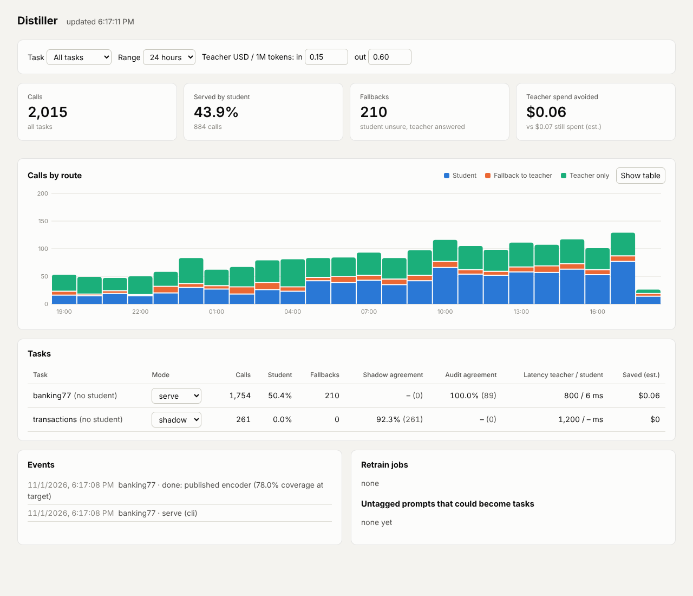

# Distiller

Turn repetitive LLM tasks into small, cheap models, and prove they are good enough before
they serve traffic.

Your app keeps calling an OpenAI-compatible API, only through Distiller's gateway. The gateway
logs what the big model ("teacher") answers, trains a small model ("student") on it, measures
how much traffic the student can take at your accuracy target, and then serves those requests
itself. Everything it is unsure about still goes to the teacher.

## How it works

1. **Observe**: the gateway passes requests to the teacher and logs them (training data).
2. **Train**: `distiller train task.yaml` cleans the data, trains an encoder and/or a small
   LLM with LoRA, calibrates confidence and picks the threshold where the student is at least
   your target accuracy (95% by default) on a held-out test set.
3. **Shadow**: the student answers in the background; the dashboard shows agreement.
4. **Serve**: confident answers come from the student, the rest from the teacher. A small share
   is audited; if agreement drops, the task goes back to shadow and (optionally) retrains.

## Where to go next

- [Quickstart](quickstart.md): from zero to a running gateway in five commands.
- [Gateway](gateway.md): modes, streaming, vLLM serving, the dashboard.
- [Security](security.md): API keys, PII scrubbing, encryption at rest.
- [Deployment](deployment.md): Postgres, several gateways, Docker.
- [Automation](automation.md): task discovery, retraining on drift, auto-promotion.
- [Architecture](ARCHITECTURE.md) and [Decisions](DECISIONS.md): how and why.
